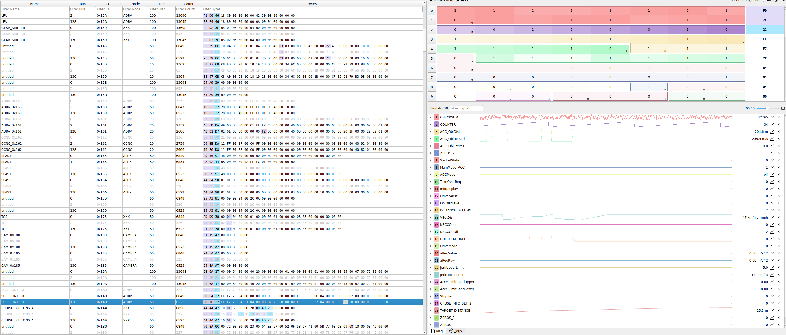
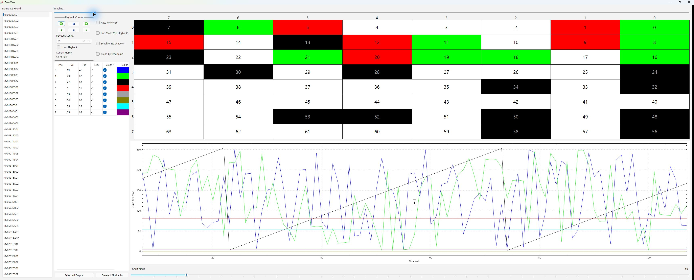

# Joongyu

**Automotive CAN reverse engineering · Embedded systems · Automated-driving research**

I investigate how vehicles communicate and build the software that connects signals, hardware, and driver-facing behavior.

[CarrotPilot collaborator](https://github.com/ajouatom/openpilot) · [Development branch](https://github.com/ajouatom/openpilot/tree/joongyu01/carrot-wip-dev) · [Live demo](https://demopilot.joongyu.co.kr/) · [Telegram](https://t.me/joongyu01)

---

### CarrotPilot

I contribute to CarrotPilot in the upstream repository, with ongoing development on `joongyu01/carrot-wip-dev`. My work focuses on Hyundai CAN-FD, stock instrument cluster integration, vehicle signaling, and diagnostics.

| Work | Evidence |
| --- | --- |
| Decode CAN-FD signals and trace vehicle behavior | [Merged blind-spot signal fix](https://github.com/ajouatom/openpilot/pull/523) |
| Integrate CCNC cluster indications with vehicle state | [Cluster integration work](https://github.com/ajouatom/openpilot/pull/558) |
| Explore radar processing and runtime behavior | [Radar load-shedding proposal](https://github.com/ajouatom/openpilot/pull/582) |
| Make development builds accessible in the browser | [Pilot_Demo](https://github.com/joongyu01/Pilot_Demo) |

### Engineering focus

**Reverse engineering**  
CAN/CAN-FD frame inspection, signal decoding, DBC investigation, and protocol analysis with Cabana and SavvyCAN. I work from captured traffic, driving logs, and code to understand behavior across vehicle states.

**Embedded systems & diagnostics**  
ESP32 / Arduino firmware, CAN monitoring, multi-bus interfaces, BLE OBD data acquisition, and EV telemetry. I connect hardware inputs to tools for inspection, logging, and validation.

**Software & tooling**  
Frontend interfaces, backend APIs, database integration, and workflow automation. I build tools that make complex systems easier to inspect, test, and use.

### Analysis workspace

<table>
<tr>
<th>Cabana · CAN-FD signal analysis</th>
<th>SavvyCAN · Bit-level inspection</th>
</tr>
<tr>
<td></td>
<td></td>
</tr>
</table>

한국어 소개

자동차 CAN/CAN-FD 통신을 분석하고, 신호와 하드웨어를 실제 기능으로 연결하는 소프트웨어를 만듭니다.

CarrotPilot 원본 저장소의 협업자로 참여하며 현대차 CAN-FD, 순정 계기판 연동, 차량 신호와 진단 기능을 개발합니다. 수집한 프레임과 주행 로그에서 동작을 파악하고, 코드와 테스트로 확인합니다.

ESP32·Arduino 펌웨어, BLE OBD 데이터 수집, 전기차 상태 모니터링과 함께 분석·검증을 위한 웹 인터페이스와 자동화 도구를 개발합니다.

